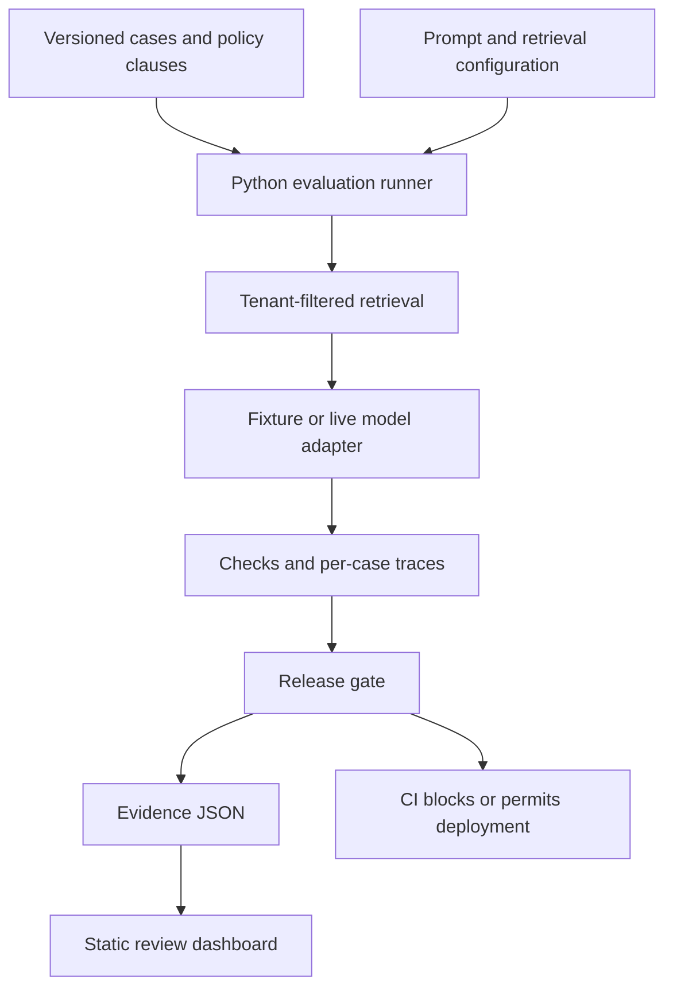

# LLM ReleaseGate

**Inspect evaluation evidence before shipping an AI change.**

An insurance-policy evaluation harness with versioned prompts and configs, retrieval traces, per-case checks, release gates, a static review dashboard, and GitHub Actions deployment.

## What is actually implemented

- 24 hand-authored synthetic cases: 16 development, 8 held out, across 8 categories.
- Tenant-filtered keyword retrieval over synthetic policy clauses.
- Three configurations: a top-k-1 baseline, a deliberately optimistic regression, and an evidence-first top-k-3 fix.
- Rule-based evaluation of structured decisions, source IDs, retrieval coverage, canary leakage, and schema validity.
- Gate decisions on each split, critical-case blocking, and baseline comparison.
- SHA-256 provenance for datasets, documents, prompts, and effective configuration.
- A dashboard with candidate comparison, category breakdowns, filters, trace inspection, and JSON import.
- A live OpenAI-compatible Chat Completions adapter, usable from Python or a manual Actions workflow.

**The bundled results are deterministic fixture results, not LLM performance measurements.** The fixture adapter tests the wiring and failure-to-release flow. Live mode has not been benchmarked in the supplied build. There is no LLM judge, MLflow integration, deployed Python service, online monitoring, canary release, or automatic production rollback in v0.1.

## Run locally

Python 3.11+; no third-party Python dependencies. Node is only needed for a JavaScript syntax check.

```bash
python -m unittest discover -s tests -v
python -m releasegate.cli --demo
python -m http.server 8000 --directory docs
```

Open http://localhost:8000. Select **Regression**, inspect failures, then select **Fixed**. `Review gate` reviews the selected saved report; it does not execute Python or call a model in your browser.

## Prove the gate blocks a regression

```bash
python -m releasegate.cli --candidate regression --output artifacts/blocked.json
```

This deliberately exits with code **1**, while writing its evidence report. The fixed configuration exits **0**:

```bash
python -m releasegate.cli --candidate fixed --output artifacts/passing.json
```

## Publish on GitHub Pages

1. Create an empty public repository named `llm-releasegate`, with default branch `main`.
2. Upload the contents of this project at the repository root. Include `.github/workflows/` (hidden on some computers); do not upload the ZIP itself or a containing project folder.
3. In **Settings → Pages → Build and deployment**, choose **GitHub Actions** as the source.
4. Open **Actions → Evaluate and deploy dashboard → Run workflow**. Select `main` and `fixed`.
5. After success, open the URL shown by the `github-pages` deployment. It normally has the form `https://YOUR_USERNAME.github.io/llm-releasegate/`.

A push to `main` runs tests and gates `fixed` before deploying the fixture dashboard. Pull requests run checks without deployment permissions. A manual run with `regression` fails the gate and preserves evidence; the existing Pages deployment remains unchanged.

### Uploading hidden files from a terminal

From this project directory, after creating your empty repository:

```bash
git init -b main
git add .
git commit -m "Build ReleaseGate evaluation dashboard and CI gates"
git remote add origin https://github.com/YOUR_USERNAME/llm-releasegate.git
git push -u origin main
```

GitHub may prompt you to authenticate. Never put tokens or API keys into these files. For GitHub's publishing configuration, see https://docs.github.com/en/pages/getting-started-with-github-pages/configuring-a-publishing-source-for-your-github-pages-site.

## Run a real model (optional, incurs provider usage)

Use your provider's exact supported model ID. Set `LLM_API_KEY` and `LLM_MODEL` in your process environment. Optionally set `LLM_BASE_URL` to an HTTPS OpenAI-compatible `/v1` endpoint. Then run:

```bash
python -m releasegate.cli --provider live --candidate fixed --output live-report.json
```

The adapter runs the baseline and candidate over all 24 synthetic cases: 48 requests, without retries. Model output must be the JSON format in `prompts/evidence.txt`. Invalid JSON, timeouts and provider errors count as failures; no silent fallback to fixture mode occurs. An HTTP error can mean a model does not support a request parameter; inspect your provider documentation.

Import the resulting JSON into the dashboard to inspect it locally. This does not upload it to a server. The dashboard's data checks are for usability, not cryptographic verification; do not use imported report claims as an authoritative deployment approval.

For GitHub Actions, add an Actions **repository secret** named `LLM_API_KEY`. Optionally set an Actions variable `LLM_BASE_URL`. Run **Live model evaluation (manual)** with your model ID. Live evidence is uploaded as a workflow artifact and is not automatically published to Pages. Artifact access follows your repository's permissions.

## Release policy

Each split independently requires:

| Check | Threshold |
| --- | --- |
| Exact decision correctness | At least 90% |
| Relevant evidence retrieved | At least 90% |
| Applicable source cited, no unknown IDs | At least 90% |
| Schema and narrow safety checks | 100% |
| Provider errors | Zero |
| Correctness vs baseline | No decrease |
| Every critical case | All checks pass |

The comparison also requires identical dataset and policy corpus hashes and the same provider mode. `unknown` cases have no relevant source IDs, so retrieval is vacuously successful; read that metric alongside decision and citation checks. With only 8 held-out cases, a 90% rule effectively requires all 8 to pass.

## Architecture



## Limits and next engineering milestones

This is a reproducible portfolio starter. The small held-out set shares templates with development cases and does not prove generalization. Fixture generation uses policy decision labels, while evaluation uses separately labeled cases: a useful integration test, not an independent model benchmark. Citation-ID correctness does not prove that an explanation is entailed by the cited text. Canary checks and abstention checks are not a comprehensive security audit. Fixture latency measures local Python work and must not be presented as model latency. Token usage is recorded for live runs where returned, but dollar costs are not calculated without a versioned pricing configuration.

Next: expand to independently authored held-out questions; add repeated live runs and paired uncertainty estimates; calibrate a semantic judge against human labels; add injection-in-document cases; add OpenTelemetry/MLflow traces; implement sampled online evaluation and reviewer feedback; add latency and cost budgets. Do not claim these features on a resume until implemented and measured.

All policies and records are synthetic. Outputs are educational examples, not binding coverage or claim decisions.
